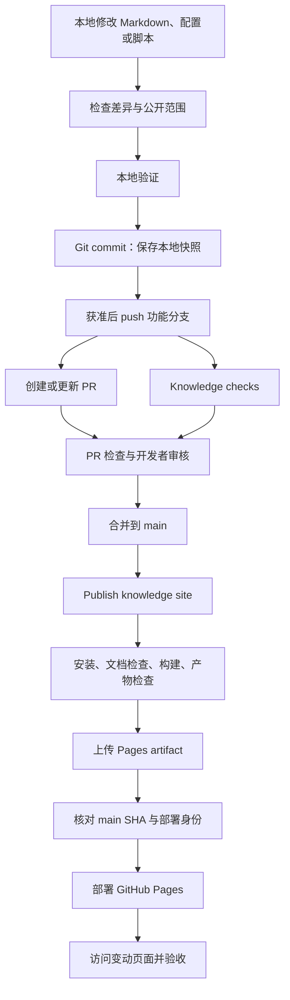

# Knowledge Hub 工程分析与维护指南

> 草稿，供审核。
> 分析日期：2026-11-01。
> 分析依据：本地代码、配置、Git 状态、项目验收记录，以及分析时读取的 GitHub 分支、规则集和 Actions 运行信息。
> 下文的改进建议均未实施，也不代表新增开发或发布授权。
> 后续交付说明：D039已通过PR #6将57f88bc及Spring新文合并发布，Linux CI与线上搜索/页面验收通过。下文保留分析时快照，当前进度以[status](project/status.md)及[完成记录](history/2026-11-01/structure-pass/completed-plans.md)为准；这些交付不等于实施本文改进建议。
> 本文保存上一轮对话的分析快照。写入时发现工作区另有知识正文和导航修改，均予以保留；这些新增修改不在本次分析范围，文中的文章数量、工作区数量和验收结果不代表新增修改已经验证。

## 1. 项目整体判断

Knowledge Hub 已经形成适合小型个人知识站的基本工程链路：

**Markdown 内容维护 → Git 版本管理 → PR 检查 → 人工审核合并 → Actions 构建 → GitHub Pages 发布。**

当前实现比较克制：网站负责阅读和搜索，本地脚本辅助资料整理，没有站点后端、数据库或在线模型服务。

工程基础已经具备，包括锁文件、文档检查、构建校验、产物引用检查、离线测试、部署权限隔离和回退说明。但还存在几个重要缺口：

1. **main 当前没有受保护标记，审核主要依赖工作约定。**
2. **PR 检查与 main 发布的验证范围不同，正式发布没有运行辅助脚本的离线测试。**
3. 浏览器交互验收已有历史证据，但尚未成为持续集成中的自动回归。
4. 已登记依赖风险，尚未修复。
5. 本地开发环境存在默认 Node 版本与项目要求不一致的问题。
6. 线上回退、真实并发部署及真实 Issue 正向往返仍未完整演练。

这些问题值得逐步补齐，但目前没有证据表明项目需要引入独立后台、数据库或复杂 Agent 平台。

## 2. 分析范围与证据边界

本次需要区分三个版本层次：

| 层次 | 分析时状态 | 含义 |
| --- | --- | --- |
| 远程 main | `9a0b160` | 本次 GitHub 查询确认的主线版本 |
| 本地当前提交 | `feat/issue-export`，`57f88bc` | 比 main 多 1 个提交 |
| 本地工作区 | 11 份文档修改，尚未提交 | 不属于任何已提交版本，也未发布 |

本地 `main`、缓存的 `origin/main` 与分析时 GitHub 返回的远程 main 一致。

因此，**不能把当前工作目录里的所有能力都当作线上版本已经具备的能力。**

具体而言：

- 无密钥 Issue 表单和离线接收已进入 main。
- 公开 Issue 导出命令仅存在于本地 `57f88bc`，分析时远程分支列表中没有 `feat/issue-export`。
- 11 份文档修改尚未进入提交。

本次核对了最新 Pages 工作流及各步骤成功状态，但没有重新完成线上浏览器验收。网站读取工具未能访问站点，本机 HTTP 请求又受到代理套接字权限限制，因此不据此声称“当前页面、搜索和资源全部复验通过”。

分析期间未重新安装依赖、构建站点或运行会写入临时文件的测试；相关测试通过次数采用已有验收记录，并明确标注覆盖版本。文档落盘后的检查另见讨论记录。

## 3. 目录结构与职责

```text
knowledge-hub/
├─ .github/
│  ├─ workflows/
│  │  ├─ check.yml             # 分支和 PR 检查
│  │  └─ pages.yml             # main 构建与 Pages 部署
│  └─ ISSUE_TEMPLATE/
│     └─ knowledge.yml         # 公开知识资料表单
├─ knowledge/
│  ├─ .vitepress/
│  │  └─ config.ts             # 站点、导航、侧栏、搜索配置
│  ├─ index.md                 # 首页
│  ├─ topics.md                # 知识目录
│  ├─ guide.md                 # 站内使用指南
│  ├─ java/、spring/等          # 按主题保存文章
│  ├─ examples/                # 阅读与搜索验证页面
│  └─ assets/images/           # 文章图片
├─ scripts/
│  ├─ check-docs.mjs           # Markdown 与本地文件链接检查
│  ├─ check-site.mjs           # 构建产物引用检查
│  ├─ ai-draft.mjs             # 可选本地模型草稿工具
│  ├─ ai-draft.test.mjs        # 模型工具离线测试
│  ├─ issue-intake.mjs         # 离线 Issue 接收
│  ├─ issue-intake.test.mjs
│  ├─ issue-export.mjs         # 本地分支新增的公开 Issue 导出
│  └─ issue-export.test.mjs
├─ docs/
│  ├─ handbook/                # 使用、开发和交付规范
│  ├─ project/                 # 当前状态、计划、决策和验收证据
│  └─ history/                 # 历史讨论与归档
├─ inbox/
│  └─ README.md                # 输入资料说明
├─ AGENTS.md                   # Agent 工作约定
├─ package.json                # 命令、依赖和运行环境要求
├─ package-lock.json           # npm 依赖锁文件
├─ .npmrc
├─ .nvmrc
├─ .gitignore
└─ .env.example                # 配置示例
```

需要特别理解三个目录边界：

- `knowledge/` 是站点内容源，构建命令为 `vitepress build knowledge`。
- `docs/` 是工程与维护文档，不会因为位于仓库中就全部成为站点页面。
- `.private/`、`inbox/local/` 是被 Git 忽略的本地目录，不提供加密、访问控制或备份。

`knowledge/README.md` 还被 `srcExclude` 显式排除。分类中的 `.gitkeep` 用于保留空目录，不代表该分类已有文章。

公开仓库中的 `docs/history/` 和 Git 历史同样公开。目录名称不能形成保密边界。

## 4. 真实技术栈

| 部分 | 实际实现 | 依据 |
| --- | --- | --- |
| 内容 | Markdown | `knowledge/` |
| 静态站点生成 | VitePress，精确版本 `1.6.4` | `package.json` |
| 主题 | VitePress 默认主题 | `config.ts`，未见自定义主题目录 |
| 配置语言 | TypeScript | `knowledge/.vitepress/config.ts` |
| 工具脚本 | JavaScript ES Modules | `"type": "module"`、`.mjs` |
| Node 要求 | `>=24.22.1 <25` | `engines`、`.nvmrc` |
| npm 要求 | `>=11 <12`，指定 `11.19.1` | `engines`、`packageManager` |
| 搜索 | VitePress 本地搜索、MiniSearch 配置 | `search.provider: 'local'` |
| 测试 | Node 内置测试运行器 | `node --test` |
| CI/CD | GitHub Actions | 两份 workflow |
| 托管 | GitHub Pages | 发布工作流及远程成功记录 |

VitePress 工具链使用 Vue、Vite 等传递依赖，但项目没有因此成为一个自行开发业务组件的 Vue 应用。当前直接声明的开发依赖只有 `vitepress`。

网站没有实现：

- 服务端 API；
- 数据库；
- 用户登录与私密访问；
- RAG 或语义搜索；
- 网页在线编辑；
- Issues 自动生成文章或自动 PR。

模型辅助使用 Node 内置 `fetch`，在本机显式调用，不参与网站阅读、构建或部署。

### 4.1 搜索机制

搜索配置采用：

```ts
text.match(/[A-Za-z0-9_]+|[\p{L}\p{N}]/gu) ?? []
```

其含义是：

- ASCII 字母、数字、下划线连续保留，适合代码标识符；
- 其他 Unicode 字母和数字逐字切分；
- 标点作为分隔；
- 查询开启前缀匹配；
- 关闭模糊匹配；
- 多个查询词采用 AND 组合。

这解决了项目曾遇到的 Node 与浏览器分词差异，但中文逐字匹配不保证短语连续性，也不等于语义理解。当前没有足够证据保证大规模语料下的相关性和性能。

## 5. Git 分支情况

远程地址为：

```text
https://github.com/EchoForge05/knowledge-hub.git
```

本次查询到 7 个远程分支：

| 远程分支 | 提交 |
| --- | --- |
| `main` | `9a0b160` |
| `feat/issue-intake` | `73292ea` |
| `feat/optional-ai-draft` | `121c6d8` |
| `feat/pages-ci` | `3bb3e2e` |
| `docs/pages-delivery` | `9ce560f` |
| `docs/delivery-receipt` | `4c8d15f` |
| `codex/ci-validation` | `6e06b24` |

本地另保留了早期开发分支，包括 `feat/site-mvp`、`feat/knowledge-pilot` 和 `docs/review-development-plan`。

分析时当前分支为：

```text
feat/issue-export
HEAD = 57f88bc
main...HEAD = 0 个主线独有提交 / 1 个当前分支独有提交
```

该分支没有配置远程跟踪分支。

多数旧分支已被 main 包含。`codex/ci-validation` 保留坏链接失败与修复实验，未合并；项目记录说明它相对分叉点没有净功能差异，不应直接视为遗漏功能。

本地没有 Git 标签。`package.json` 中的 `0.1.0` 只是包元数据，不能据此推断每次站点发布都有版本标签或 Release。

维护上应区分：

- 分支：开发中的工作线；
- commit：一次确定的版本快照；
- PR：审核与合并载体；
- Actions run：某次自动化执行；
- deployment：一次实际发布。

这些对象相关，但不能互相替代。

## 6. GitHub Pages 实际部署方式

**当前采用 GitHub Actions 自定义工作流部署。**

它不是将 `main/docs` 或 `gh-pages` 分支中的文件直接作为发布源。

证据包括：

1. `.github/workflows/pages.yml` 完整定义构建、上传和部署。
2. 上传目录为 `knowledge/.vitepress/dist`。
3. 部署使用 `actions/deploy-pages@v4`。
4. 历史部署证据记录 Pages `build_type: workflow`。
5. 本次 GitHub 查询确认最新发布运行成功：

| 项目 | 值 |
| --- | --- |
| Workflow | `Publish knowledge site` |
| 触发事件 | `push` |
| 分支 | `main` |
| 提交 | `9a0b160` |
| Run ID | `41283825644` |
| build | success |
| deploy | success |

[查看本次核对的 Pages 发布运行](https://github.com/EchoForge05/knowledge-hub/actions/runs/41283825644)。

这里“main 驱动发布”指 main 更新触发 Actions，并不表示使用 Pages 的“Deploy from a branch”模式。GitHub 官方将这种构建并上传产物的方式定义为自定义工作流发布。[官方说明](https://docs.github.com/en/pages/getting-started-with-github-pages/using-custom-workflows-with-github-pages)

历史证据还记录 HTTPS 开启、`github-pages` 环境只允许 main 分支部署。本次未重新读取这些后台设置，因此它们应视为历史已验证配置，不能声称刚刚全部复核。

## 7. 两份 Workflow 逐行解释

以下行号对应分析时读取的实际文件。空行只分隔结构，不影响行为。

### 7.1 `check.yml`：分支与 PR 检查

| 行号 | 配置 | 解释 |
| --- | --- | --- |
| 1 | `name: Knowledge checks` | Actions 页面显示的工作流名称 |
| 3 | `on:` | 声明触发事件 |
| 4 | `pull_request:` | 响应 PR 事件 |
| 5 | `branches: [main]` | 筛选 PR 的目标分支为 main |
| 6 | `push:` | 同时响应分支推送 |
| 7 | 四组分支模式 | `feat/`、`fix/`、`docs/`、`codex/` 分支推送时运行 |
| 8 | `workflow_dispatch:` | 允许手动运行 |
| 10 | `permissions:` | 设置工作流 token 权限 |
| 11 | `contents: read` | 只授予仓库内容读取权限 |
| 13 | `concurrency:` | 设置并发分组 |
| 14 | `checks-${{ ... }}` | PR 按编号分组，其他事件按 Git ref 分组 |
| 15 | `cancel-in-progress: true` | 同组新运行取消旧运行 |
| 17 | `jobs:` | 声明任务集合 |
| 18 | `check:` | Job 的机器标识 |
| 19 | `name: Documents and site` | Job 的显示名称 |
| 20 | `runs-on: ubuntu-latest` | 使用 GitHub 托管 Ubuntu runner |
| 21 | `timeout-minutes: 10` | Job 最长运行 10 分钟 |
| 22 | `steps:` | 后续步骤顺序执行 |
| 23 | `actions/checkout@v7` | 检出本次运行对应的代码 |
| 24 | `with:` | 传入 Action 参数 |
| 25 | `persist-credentials: false` | 不将检出凭据持久保留在本地 Git 配置 |
| 26 | `actions/setup-node@v7` | 准备 Node 运行环境 |
| 27 | `with:` | Node Action 参数 |
| 28 | `node-version: '24.22.1'` | CI 固定 Node 版本 |
| 29 | `package-manager-cache: false` | 关闭包管理器自动缓存 |
| 30 | `name: Select npm` | 给选择 npm 的步骤命名 |
| 31 | `npm install --global ...` | 在临时 runner 安装 npm 11.19.1，禁用安装脚本 |
| 32 | `name: Install locked dependencies` | 给依赖安装步骤命名 |
| 33 | `npm ci --ignore-scripts` | 按锁文件安装依赖，不运行依赖安装生命周期脚本 |
| 34 | `npm run check` | 检查 Markdown 与本地文件链接 |
| 35 | 模型测试步骤名称 | 说明下一条命令用于离线测试 |
| 36 | `npm run test:ai` | 运行模型辅助脚本测试，不进行真实模型调用 |
| 37 | Issue 测试步骤名称 | 说明下一条命令用于人工接收流程测试 |
| 38 | `npm run test:issue` | 测试范围由该提交的 package.json 决定 |
| 39 | `npm run build` | 构建静态站点 |
| 40 | `npm run check:site` | 检查生成页面、资源、锚点和 base 路径 |

`pull_request` 没有指定 `types`，使用默认活动类型，因此不是所有 PR 状态变化都会重新运行。上述触发、权限、并发和 Job 依赖语义以 GitHub 官方工作流规范为依据。[Workflow 语法](https://docs.github.com/en/actions/reference/workflows-and-actions/workflow-syntax)

两个容易忽略的细节：

- 推送一个已有 PR 的功能分支，可能同时产生 push 和 PR 两次运行。它们的并发组不同，不会互相取消。
- PR 检查默认检出的是 PR 合并测试引用，用于检查与目标分支组合后的结果；功能分支 push 检查针对分支提交。两次检查的意义并不完全相同。

当前 main 的 `test:issue` 覆盖 9 项接收测试；本地 `57f88bc` 将其扩展为 9 项接收测试加 5 项导出测试。不能把此前 PR 的 Linux 成功结果算作这 5 项新增测试已经通过 Linux。

### 7.2 `pages.yml`：构建与部署

| 行号 | 配置 | 解释 |
| --- | --- | --- |
| 1 | `name: Publish knowledge site` | 发布工作流名称 |
| 3 | `on:` | 声明触发条件 |
| 4 | `push:` | 响应推送 |
| 5 | `branches: [main]` | 仅 main 推送自动触发 |
| 6 | `workflow_dispatch:` | 允许手动运行 |
| 8 | `permissions:` | 工作流默认权限 |
| 9 | `contents: read` | 默认只读仓库内容 |
| 11 | 注释 | 说明部署共享并发组 |
| 12 | `concurrency:` | 开始声明并发控制 |
| 13 | `group: github-pages` | 所有此工作流运行使用同一组 |
| 14 | `cancel-in-progress: true` | 新运行取消同组旧运行 |
| 16 | `jobs:` | 声明任务集合 |
| 17 | `build:` | 构建 Job |
| 18 | `if: github.ref == ...` | 只有 main ref 才执行 |
| 19 | `runs-on: ubuntu-latest` | 使用 Ubuntu runner |
| 20 | `timeout-minutes: 10` | 构建最多 10 分钟 |
| 21 | `steps:` | 构建步骤开始 |
| 22 | `actions/checkout@v7` | 检出代码 |
| 23 | `with:` | 检出参数 |
| 24 | `persist-credentials: false` | 不持久保存检出凭据 |
| 25 | `actions/setup-node@v7` | 准备 Node |
| 26 | `with:` | Node 参数 |
| 27 | `node-version: '24.22.1'` | 固定 Node |
| 28 | `package-manager-cache: false` | 禁用自动包管理器缓存 |
| 29 | `name: Select npm` | npm 选择步骤名称 |
| 30 | 安装 npm 命令 | 安装 npm 11.19.1，并禁用安装脚本 |
| 31 | 依赖安装步骤名称 | 标识锁文件安装步骤 |
| 32 | `npm ci --ignore-scripts` | 按锁文件安装依赖 |
| 33 | `npm run check` | 检查文档 |
| 34 | `npm run build` | 生成静态站点 |
| 35 | `npm run check:site` | 验证构建产物引用 |
| 36 | `actions/upload-pages-artifact@v3` | 打包并上传 Pages 产物 |
| 37 | `with:` | 上传参数 |
| 38 | `path: knowledge/.vitepress/dist` | 只上传站点构建目录 |
| 39 | `retention-days: 1` | 工作流产物保留 1 天 |
| 41 | `deploy:` | 部署 Job |
| 42 | main ref 条件 | 再次限制部署来自 main |
| 43 | `needs: build` | 依赖 build 成功完成 |
| 44 | `runs-on: ubuntu-latest` | 部署使用另一个 runner |
| 45 | `timeout-minutes: 10` | 部署最多 10 分钟 |
| 46 | `permissions:` | 单独声明部署权限 |
| 47 | `contents: read` | 读取仓库与 main 引用 |
| 48 | `pages: write` | 允许创建 Pages 部署 |
| 49 | `id-token: write` | 允许申请部署身份用的 OIDC token |
| 50 | `environment:` | 关联 GitHub 部署环境 |
| 51 | `name: github-pages` | 使用名为 github-pages 的环境 |
| 52 | `url: ${{ ...page_url }}` | 展示部署步骤输出的站点地址 |
| 53 | `steps:` | 部署步骤开始 |
| 54 | 旧提交拒绝步骤名称 | 声明部署前的 SHA 检查 |
| 55 | `env:` | 给该步骤传入环境变量 |
| 56 | `GH_TOKEN: ${{ github.token }}` | 使用 GitHub 为运行提供的临时 token |
| 57 | `REPOSITORY: ...` | 当前仓库标识 |
| 58 | `EXPECTED_SHA: ...` | 本次工作流对应的提交 |
| 59 | 多行 run 字段 | 以下是多行 Shell 脚本 |
| 60 | `gh api ... --jq .object.sha` | 请求远程 main 的最新 SHA |
| 61 | `test "$actual_sha" = ...` | 不一致则非零退出，阻止后续部署 |
| 62 | `actions/configure-pages@v5` | 获取并准备 Pages 配置 |
| 63 | `name: Deploy site` | 部署步骤名称 |
| 64 | `id: deployment` | 提供供其他表达式引用的步骤 ID |
| 65 | `actions/deploy-pages@v4` | 发布前面上传的 Pages 产物 |

`needs: build`、Pages/OIDC 权限和环境关联符合官方自定义 Pages 部署机制。[Pages 部署要求](https://docs.github.com/en/pages/getting-started-with-github-pages/using-custom-workflows-with-github-pages#deploying-github-pages-artifacts)

几个关键解释：

**构建与部署运行在不同 runner。** 两者通过上传的 artifact 传递站点文件，不共享本地工作目录，所以 deploy 不需要重新构建。

**artifact 保留 1 天不意味着网站只存在 1 天。** 它限制的是 Actions 中上传产物的保留期。

**`id-token: write` 不等于任意写仓库。** 它允许申请 OIDC 身份凭证，与 `contents: write` 是不同权限。

**部署前 SHA 检查降低旧版本覆盖风险，但不是原子锁。** 检查结束到部署完成之间仍有时间窗口；并发取消配合 SHA 检查提供防护，但项目尚未动态验证真实竞争场景。

此外，并发组覆盖手动运行。手动选择非 main 时两个 Job 会跳过，但该运行仍属于同一工作流并发组，操作时应注意对其他运行的影响。

## 8. 从本地修改到网站更新



各阶段的实际含义：

1. **修改文件**：只改变工作目录。
2. **`git add`**：选择下一次提交的内容，不会自动包含所有文件。
3. **`git commit`**：在本地生成快照，不会更新 GitHub。
4. **push 功能分支**：上传提交并触发检查，当前配置不会发布该分支的网站。
5. **创建 PR**：提供差异、检查结果和审核入口，不会自动合并。
6. **合并 main**：产生 main 更新，触发现有发布工作流。
7. **build 成功**：只表示产物生成和检查通过。
8. **deploy 成功**：表示部署步骤成功，还需页面、资源和交互验收。

对本项目而言，PR 合并通常就是实际发布入口。审核者批准 main 变更时，应同时考虑它即将触发公开发布。

还有两个维护细节：

- 没有路径过滤，main 上只修改工程文档也会重新构建和部署。
- `docs/` 更新可能不会改变网站页面，但仍会运行检查和发布流程。

## 9. 工程保障是否完善

### 9.1 自动化测试：有基础，覆盖仍有限

| 检查 | 已有能力 | 主要限制 |
| --- | --- | --- |
| Markdown 检查 | UTF-8、一级标题规则、本地文件目标存在性 | 不验证外链、技术事实和 Markdown 标题锚点 |
| 站点构建 | 验证 VitePress 能否生成站点 | 不验证浏览器交互 |
| 产物检查 | HTML 中本地页面、资源、锚点、base | 使用正则提取引用，覆盖不了全部浏览器加载行为 |
| 模型辅助测试 | 7 项离线测试 | 不等于真实服务兼容性或费用验证 |
| Issue 接收测试 | main 已有 9 项 | 真实表单和正向往返仍待验收 |
| Issue 导出测试 | 本地新增 5 项 | 尚未进入远程 Linux CI |
| 浏览器验收 | 有历史搜索、跳转、桌面和模拟手机证据 | 未加入持续运行的 workflow |

`check-docs.mjs` 还有两个值得注意的实现边界：

- 以 `---` 开头的文档跳过该脚本的一级标题数量检查，不能认为所有 Markdown 都严格检查了一个 H1。
- 遍历逻辑没有通用读取 `.gitignore`。本地被忽略的 `inbox/local/` 中若有 Markdown，也可能进入检查；CI 干净检出通常没有这些文件，可能出现本地与 CI 检查范围不同。

当前没有持续集成中的浏览器回归步骤，也没有统一的 `npm test` 或一条完成所有验证的脚本。

### 9.2 构建校验：较好，但发布检查范围不完整

优点：

- VitePress 精确版本及 npm 锁文件已存在。
- `.npmrc` 启用 `engine-strict`。
- CI 固定 Node/npm。
- 使用 `npm ci --ignore-scripts`。
- 构建之后检查产物，而非只检查源文件。
- build 失败时不会正常进入 deploy。

缺口：

**`pages.yml` 没有运行 `test:ai` 和 `test:issue`。**

它也没有配置为等待另一份 `check.yml` 成功后才部署。若绕过 PR 直接更新 main，辅助脚本测试不会成为该次发布的门槛。

### 9.3 分支保护：当前主要靠约定

本次 GitHub 查询返回：

- `main` 的 `protected: false`；
- 仓库 rulesets 列表为 `[]`；
- 详细保护接口返回 403，当前连接器无权读取管理细节。

据当前可见结果，**没有看到服务端强制 PR 审核或必需检查的保护。**

403 表示连接器权限不足，不能单独作为“没有保护”的证据；上述判断主要依据分支标记与规则集查询结果。

这意味着“走 PR、用户审核、CI 成功再合并”目前主要是团队和 Agent 的流程约定，未形成充分的平台强制约束。分支保护可以把审核与状态检查变成服务端合并条件。[官方分支保护说明](https://docs.github.com/en/repositories/configuring-branches-and-merges-in-your-repository/managing-protected-branches/about-protected-branches)

**部署环境只允许 main，不等于 main 受到保护。** 前者限制从哪里部署，后者限制谁能怎样改变发布源。

### 9.4 敏感信息管理：有多层防护，不能保证零泄露

已有措施：

- 忽略 `.env`、`.env.*`、私钥文件、`.private/`、`inbox/local/`。
- 保留 `.env.example` 作为示例。
- 本次受版本管理路径查询中，只返回 `.env.example`，未返回上述私有目录文件。
- 模型和 Issue 工具检测部分常见凭据格式。
- 输入路径、大小、UTF-8 和输出路径均有校验。
- 模型默认预览，显式 `--send` 才调用。
- Issue 默认预览，显式操作才导出或接收。
- 错误输出避免回显原始资料和服务响应。
- PR Job 只读，部署 Job 单独获得 Pages 权限。
- 没有 `pull_request_target` 或 Issue 后台触发。

仍需明确：

- `.gitignore` 不会删除已经被跟踪或进入历史的秘密。
- 凭据正则不能识别所有密钥、个人信息和业务敏感内容。
- “公开确认”勾选和 JSON 作者字段不构成身份认证。
- 仓库未配置持续执行的秘密扫描步骤；GitHub 后台秘密扫描开关本次未核实。
- 本次没有对完整 Git 历史进行秘密审计，不能证明历史绝无敏感信息。

模型脚本的使用授权还存在“流程强于程序”的特点：

- 模型名来自环境变量，没有在代码中强制限定为 `gpt-6-sol`。
- 输出上限代码允许到 8192，而本批历史授权为每次 4096。
- 没有累计次数或金额预算控制。

所以代码可配置的范围不等于 Agent 获准使用的范围。既有 3 次调用额度已耗尽，不能因为脚本能运行就追加调用。

### 9.5 版本回滚：有方案与隔离验证，线上未演练

当前回退方案：

1. 定位错误提交与已验证恢复点。
2. 创建短期分支。
3. 使用 `git revert` 生成反向提交。
4. 检查差异并完成验证。
5. 提交回退 PR，由用户审核。
6. 合并 main 后按正常流程重新发布。

项目已有隔离副本中的真实 revert 证据：撤销 `14cc80b` 后，恢复树与 `70c8365` 一致，文档、构建、产物检查通过。

但它没有验证：

- 公开站点实际回退耗时；
- CDN 与浏览器缓存影响；
- 生产环境紧急回退；
- 同时存在多次部署时的回退行为。

旧 Actions 运行也不是可靠的直接回退入口：旧提交会因 main SHA 不一致而被拒绝，artifact 又只保留一天。

因此，应继续使用“新的 revert 提交 → 正常发布”恢复内容，并提前确认合并提交的父线，避免撤销错误范围。

## 10. 技术风险与维护问题

| 风险 | 依据 | 影响 |
| --- | --- | --- |
| main 缺少强制保护 | 分支标记与 rulesets 查询 | 流程可能被直接推送绕过 |
| 发布未跑全部离线测试 | 两份 workflow 内容不同 | main 上辅助脚本回归可能不阻止发布 |
| 本地 Node 不匹配 | 本次默认 Node 为 `v14.21.3` | 安装、构建或脚本运行失败 |
| 使用本机临时工具路径 | 开发说明依赖缓存 Node、私有 npm 路径 | 新环境难以直接复现 |
| 依赖风险未处理 | 已登记 M01、历史 audit | 开发与构建环境存在已知风险 |
| Action 引用使用版本标签 | `@v7`、`@v5` 等 | Action 实现没有锁到不可变 SHA |
| `ubuntu-latest` 随平台变化 | 两份 workflow | 构建环境并非完全固定 |
| UI 回归依赖历史人工验收 | workflow 无浏览器步骤 | 搜索和布局回归可能漏检 |
| 导航手工维护 | 配置、topics、正文分离 | 新文章可能漏入口或出现不一致 |
| 检查脚本覆盖有限 | 正则提取 Markdown/HTML | 部分链接、动态资源或语法问题漏检 |
| 文档和分支较多 | 分析时 11 份未提交文档与历史分支 | 容易混淆本地、main 和线上状态 |
| Issue 正向往返未验收 | V06 | 无法保证真实表单到接收的整条流程 |
| 发布后没有自动探测 | deploy 后无站点请求步骤 | 工作流成功后仍需人工发现页面异常 |

历史依赖审计记录为 3 个受影响包：2 项 moderate、1 项 high，涉及 VitePress/Vite/esbuild 链路。这是项目保存的审计快照，本次没有重新执行在线审计，不能把它当作当前完整漏洞清单。

相关依赖主要用于开发和构建；不能直接推断公开静态站点存在同等可利用漏洞，也不能因此忽略开发环境风险。

另一个代码层面的小问题是：模型响应先执行 `response.text()`，再判断是否超过 1 MiB。这能阻止过大响应继续处理，却不能在读取过程中限制内存占用。Issue 导出已经采用流式字节限制，可在后续维护时评估是否统一。

## 11. Agent 与开发者的职责边界

Agent 能完成技术执行，不代表所有执行都已获得授权。

| 工作 | 建议职责 |
| --- | --- |
| 阅读代码、分析 Git、查询 CI | Agent 可自动完成 |
| 搜索重复主题、检查链接、比对文档 | Agent 可自动完成 |
| 在已授权范围修复代码、补测试 | Agent 执行，输出可审阅差异 |
| 运行离线测试、构建和产物检查 | Agent 可自动完成 |
| 生成 PR 描述、回退方案、交付回执 | Agent 可准备 |
| 验证通过后的本地开发提交 | 按 D023 及当次范围执行 |
| push、创建公开 PR | 依当次授权执行 |
| 合并 PR | 开发者审核；历史单次授权不自动延续 |
| 修改 workflow 权限、分支保护、部署设置 | 开发者审核后执行 |
| 密钥配置、登录、账户身份 | 开发者提供或确认 |
| 真实模型调用与费用 | 必须有明确有效的当次授权 |
| 公开测试 Issue、发布原始资料 | 先审核公开内容与操作范围 |
| 线上回退、删除分支、强推 | 开发者明确审核；项目禁止擅自强推 |
| 技术事实与敏感内容最终判断 | Agent 辅助，维护者负责审核 |

适合当前项目的分工是：

**Agent 负责准备完整成果和验证证据；开发者审核公开内容、权限、费用与合并发布决策。**

本次任务仅分析和保存文档，不能套用以前的提交、推送或合并授权。

## 12. 按优先级排序的改进建议

以下全部为待审核建议。

### 12.1 P0：把发布入口的关键约定变成强制保障

**1. 为 main 配置适度的分支保护。**

建议至少评估：

- 必须经 PR 合并；
- 要求 `Documents and site` 检查成功；
- 阻止强推和删除；
- 限制绕过权限；
- 有协作者时配置合理的审核人数。

单人仓库不宜机械要求本人无法满足的审批人数。目标是形成实际可执行的保护。

验收应包括：一个检查失败的 PR 确实不能按普通流程合并，而不只是截图证明开关存在。

**2. 对齐 main 发布与 PR 的验证范围。**

优先考虑在 main 的 build Job 中也运行两组离线测试。当前项目较小，直接补齐比引入复杂的跨工作流联动更容易理解。

验收标准是辅助脚本测试失败时，产物不会进入部署。

**3. 重新核实已登记依赖风险，制定升级方案。**

先获取最新审计结果，区分受影响场景，再评估兼容补丁或迁移成本。不要直接执行强制依赖升级。

### 12.2 P1：提高验证连续性与环境可复现性

**4. 提供统一验证命令。**

统一串联文档、离线测试、构建、产物检查，减少维护者遗漏。两份 workflow 应复用相同的验证定义，避免长期漂移。

**5. 增加少量高价值浏览器回归。**

先覆盖最容易发生回归的行为：

- 中文和代码标识符搜索；
- 搜索结果跳到正确小节；
- `/knowledge-hub/` 子路径资源；
- 手机目录与导航。

不必一开始建设大规模端到端测试。

**6. 简化标准开发环境。**

让新机器可以依靠标准 Node 24/npm 11 完成安装和构建，逐步减少对个人缓存路径及 `.private/tools` 的依赖。

验收重点是干净环境可复现，而不只是当前电脑可运行。

**7. 增加秘密扫描并核对 GitHub 后台能力。**

在保留现有脚本防护的同时，检查提交和历史风险。扫描报告也必须避免回显完整秘密。

**8. 完成已有待交付与待验收事项。**

先按授权交付 `57f88bc`，取得新增测试的 Linux CI 证据；再使用获准公开的真实 Issue 验证导出、离线接收与人工处理。

### 12.3 P2：降低长期维护成本

**9. 评估将 Actions 锁定到完整提交 SHA。**

完整 SHA 能提高供应链引用的不可变性，但需要配套更新机制，避免长期不升级。[GitHub Actions 安全加固指南](https://docs.github.com/en/actions/security-for-github-actions/security-guides/security-hardening-for-github-actions)

**10. 增加发布后最小探测。**

部署后检查首页、代表文章和关键资源，再补一组搜索交互。应允许合理的传播等待，避免一次瞬时请求失败就判定发布损坏。

**11. 完善恢复点记录。**

记录已验证部署 SHA、运行链接和恢复步骤；必要时增加少量里程碑标签。无需为每篇文章更新创建复杂 Release。

**12. 减少手工导航与检查范围差异。**

优先增加正文、topics 和 sidebar 的一致性检查，并明确文档检查是否排除本地输入目录。文章数量增长后，再决定是否生成导航。

**13. 审核后整理历史分支和文档入口。**

保留必要实验记录，避免将已合并分支长期误认为待交付功能。清理分支需单独审核，不应在分析任务中自动执行。

## 13. 后续学习与维护入口

建议结合实际文件阅读，以下代码路径均相对于仓库根目录：

1. `package.json`：理解项目能运行哪些命令。
2. `knowledge/.vitepress/config.ts`：理解内容如何变成导航、页面和搜索。
3. `scripts/check-docs.mjs`、`scripts/check-site.mjs`：理解“检查通过”覆盖什么、遗漏什么。
4. `.github/workflows/check.yml`：理解 PR 质量检查。
5. `.github/workflows/pages.yml`：理解发布权限、构建产物和部署。
6. [发布与回退](handbook/github-delivery.md)：理解故障定位和回退。
7. [当前进度](project/status.md)、[待办登记](project/backlog.md)：区分已实现、已交付和已验收。
8. [Agent 工作约定](../AGENTS.md)：理解技术能力与操作授权的边界。

日常交付时，始终确认四件事：**审阅的是哪个提交、运行了哪些检查、合并会触发什么、失败后如何恢复。**
